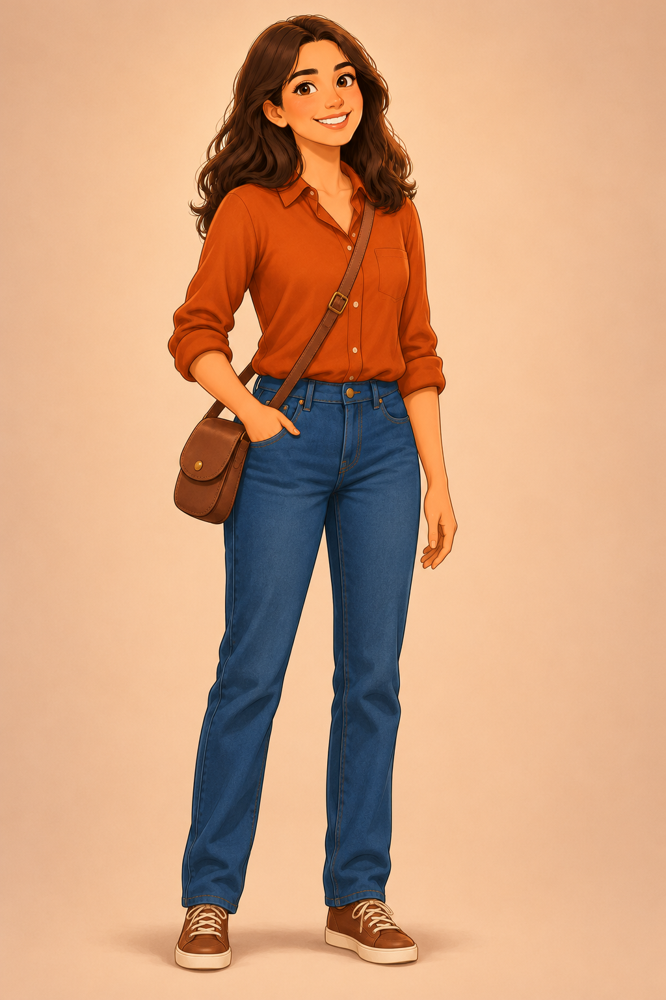
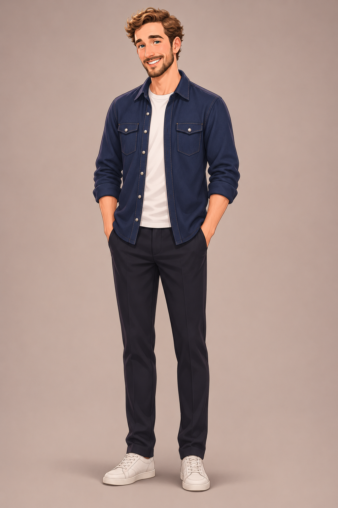
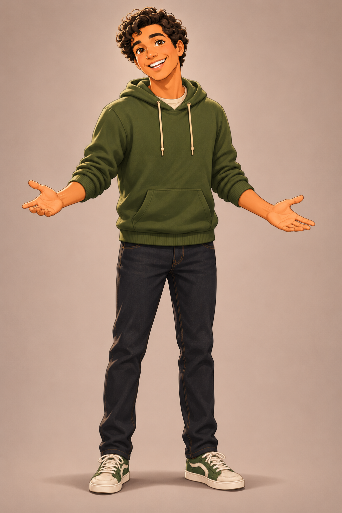
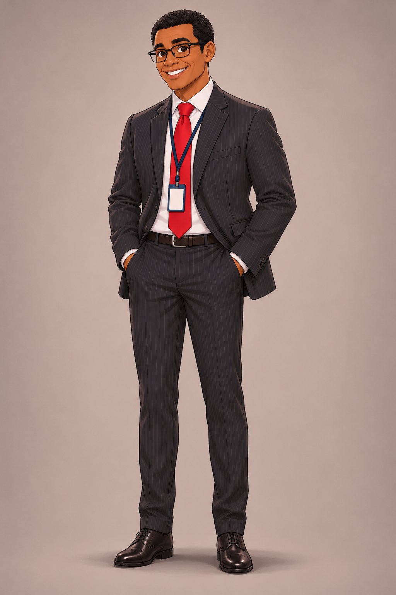
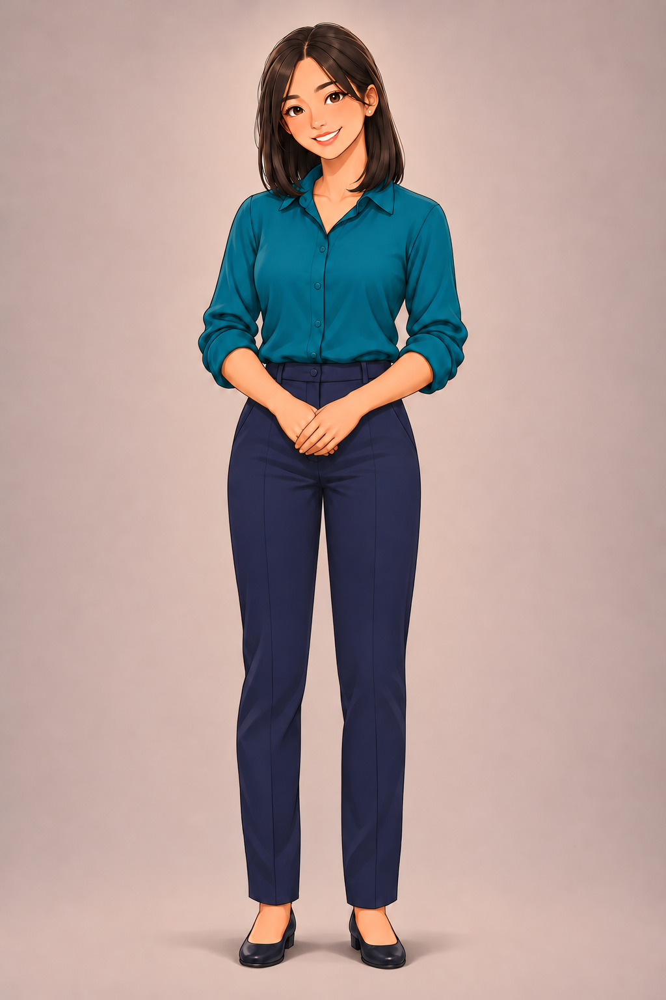

# Personagens recorrentes

Use esta página como guia de identidade visual ao criar ou editar ilustrações do curso. Consulte a imagem de corpo inteiro de cada personagem junto com as ilustrações originais da A1 Unit 1, Lesson 1. Preserve rosto, cabelo, tom de pele e silhueta entre cenas; roupas, pose e acessórios podem variar conforme o contexto.

As imagens abaixo são referências internas de produção. Não são assets de lesson e não devem ser adicionadas ao `local-media/` nem enviadas ao R2.

## Laura Palmer

- Jovem adulta de pele morena clara e quente, olhos castanhos grandes e expressivos, rosto suavemente arredondado e sorriso acolhedor.
- Cabelo castanho-escuro, longo, espesso e ondulado.
- Presença aberta, amigável e confiante.
- A blusa terracota e a bolsa transversal marrom são da cena de apresentação; não precisam aparecer em outras situações.

## Eric Silva

- Homem britânico jovem adulto, pele clara com subtom levemente frio, olhos azul-esverdeados e rosto mais longo e estreito.
- Cabelo castanho-claro levemente ondulado, nunca preto; nariz reto e estreito, maçãs do rosto finas e barba castanha média, curta e bem aparada.
- Aparência contemporânea e polida, expressão simpática porém mais reservada que a de Pedro.
- A camisa azul sobre camiseta branca é a roupa da cena de apresentação. Em outros contextos, use peças discretas em marinho, verde-escuro, vinho ou carvão.

## Pedro

- Jovem adulto brasileiro de pele morena média quente, olhos castanho-escuros, cabelo naturalmente preto e cacheado e rosto arredondado e amigável.
- Sempre sem barba: não adicionar bigode, cavanhaque, pelos no queixo ou sombra de barba.
- Postura e expressão abertas, energéticas e relaxadas. Um boné verde pode aparecer em cenas casuais ao ar livre, mas não é obrigatório.
- Mantenha-o visualmente distinto de Eric: Pedro é mais quente, arredondado e expressivo; Eric é mais claro, estreito e tem barba curta.
- A blusa de moletom verde da referência é específica do retrato; adapte as roupas à cena.

## Tony

- Homem negro adulto de pele marrom-escura quente, cabelo preto curto e crespo, olhos castanhos escuros e óculos retangulares pretos.
- Sorriso confiante e acolhedor; aparência profissional e postura tranquila.
- É o gerente. Terno carvão, camisa branca, gravata vermelha e crachá pertencem ao contexto profissional da Lesson 1; não reutilize esses acessórios fora dele.

## Naomi

- Jovem adulta nipo-brasileira de pele clara quente, olhos castanhos escuros amendoados, rosto oval suavemente arredondado e sorriso gentil.
- Cabelo preto liso, na altura dos ombros, com risca lateral discreta.
- É a recepcionista. Blusa teal, calça azul-marinho, tablet e crachá representam o contexto profissional da Lesson 1; adapte roupas e acessórios a outras cenas.

## Estilo das ilustrações

- Ilustração digital 2D semirrealista, contornos desenhados limpos, rostos levemente estilizados, cores quentes, sombreamento pictórico suave e ambientes detalhados.
- Não usar aparência fotográfica, vetor plano genérico ou caricatura.
- Para manter a continuidade, use também os assets originais de A1 Unit 1, Lesson 1 como referência de estilo e identidade.
